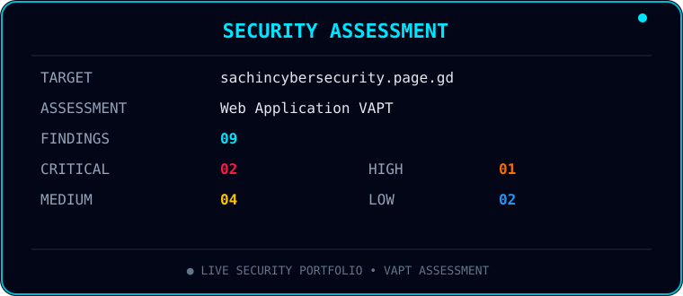

<!-- ========================================================= -->
<!--  HEADER                                                   -->
<!-- ========================================================= -->

<p align="center">
  
</p>

<p align="center">
  <a href="https://sachincybersecurity.page.gd/"></a>
  <a href="./Pentest_Report_sachincybersecurity.pdf"></a>
  <a href="https://github.com/sachinpatil19-cyber-security"></a>
</p>

<p align="center">
  
  
  
  
</p>

<p align="center">
  <em>A hands-on web application vulnerability assessment and penetration test of my own cybersecurity portfolio website.</em>
</p>

---

## What this report shows

| | |
|---|---|
| **Role fit** | VAPT / Cyber Security Associate |
| **Target** | My own portfolio website ([sachincybersecurity.page.gd](https://sachincybersecurity.page.gd/)) |
| **Focus areas** | Authentication · Session management · Input validation |
| **Deliverable** | Client-style report with scope, methodology, risk-rated findings, PoC and remediation |

---

## Report at a glance

<!-- EDIT: replace X with the real numbers from your PDF -->

| **X** <br> Total Findings | **X** <br> High / Critical | **X** <br> Medium | **X** <br> Low / Info |
|:---:|:---:|:---:|:---:|

---

## Methodology

```text
Reconnaissance → Vulnerability Identification → Manual & Automated Testing
      → Exploitation Validation → Proof of Concept → Remediation & Reporting
```

| Phase | What was done |
|---|---|
| **1. Recon** | Mapped the attack surface, technologies and entry points |
| **2. Identification** | Scanned and reviewed for known weakness classes |
| **3. Testing** | Manual and automated testing of auth, sessions and inputs |
| **4. Validation** | Confirmed exploitability and removed false positives |
| **5. PoC** | Documented reproducible steps and evidence |
| **6. Reporting** | Risk-rated findings with clear remediation guidance |

---

## Focus areas

| Area | What was checked |
|---|---|
| **Authentication** | Login flow, credential handling, access control |
| **Session management** | Cookie flags, session lifetime, token handling |
| **Input validation** | Injection and XSS-type weaknesses, error handling |

---

## Key findings

<!-- EDIT: replace the example rows with the real findings from your report -->

| # | Finding | Severity | Status |
|:---:|---|:---:|:---:|
| 1 | _Finding title_ |  | Fixed |
| 2 | _Finding title_ |  | Fixed |
| 3 | _Finding title_ |  | Open |

---

## Tools used

<!-- EDIT: remove any tool you did not use in this assessment -->

<p>
  
  
  
  
  
  
</p>

---

## Repository contents

| File | Description |
|---|---|
| [`Pentest_Report_sachincybersecurity.pdf`](./Pentest_Report_sachincybersecurity.pdf) | Full penetration testing report |
| [`security-assessment-animated.svg`](./security-assessment-animated.svg) | Animated assessment dashboard |

<p align="center">
  
</p>

---

## Scope and ethics

All testing was performed on a website I own, with full authorization. No third-party systems were tested. Please do not use anything here against systems you do not own or have written permission to test.

---

<p align="center">
  <strong>Open to VAPT / Cyber Security Associate roles</strong> — Web, API and Network penetration testing<br><br>
  <a href="https://github.com/sachinpatil19-cyber-security">GitHub</a> ·
  <a href="https://sachincybersecurity.page.gd/">Portfolio</a> · Mumbai, Maharashtra
</p>

<p align="center">
  
</p>
